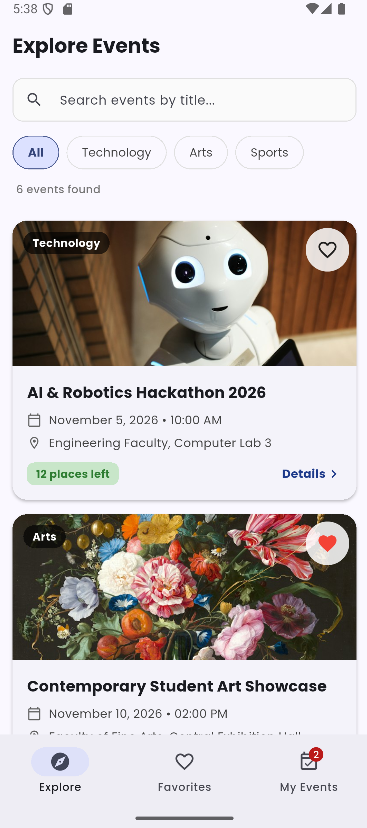
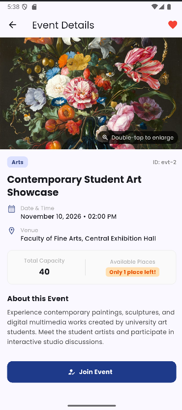
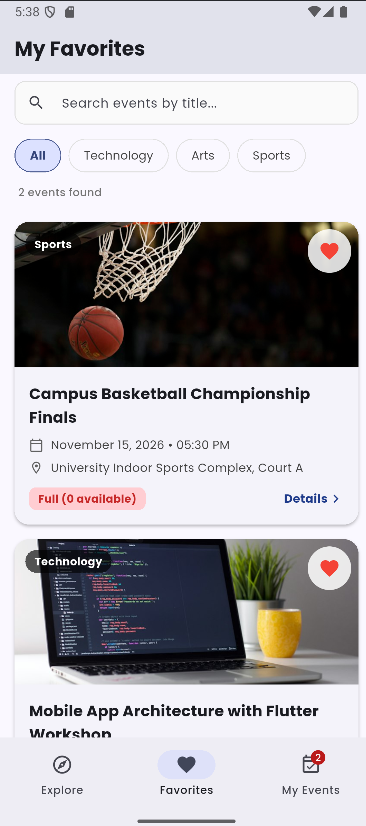
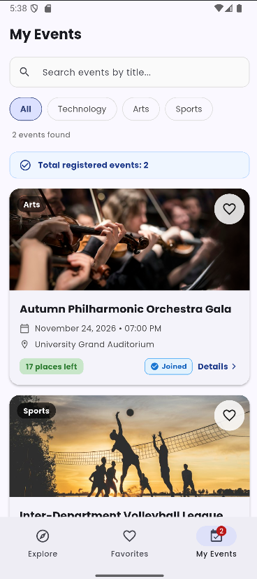

# Campus Event Explorer
**BIM493 - Mobile Programming I | Assignment #1**

A cross-platform Flutter mobile application designed for students to explore campus events, manage favorites, and track event participation with real-time capacity and in-memory state management.

---

## Team Information & Contributions

| Member Name | Student ID | Contribution |
| :--- | :--- | :--- |
| **Burak Haşimoğlu** | `50206821060` | State management architecture, navigation structure, details screen, and confirmation dialogs. |
| **Ahmet Melih Bulut** | `57844176248` | Reusable UI widgets, search & category filtering, asset management, and test suite verification. |


---

## Required Flutter Version

This project was built and validated on **Flutter 3.47.6** on the **Stable channel**

---

## Setup & Running the Application

### Prerequisites
- Flutter SDK `3.47.6` installed on the `stable` channel.
- An active emulator, simulator, or connected physical device (or Chrome / Windows desktop).

### Setup Commands
1. Clone the repository and navigate into the project directory:
   ```bash
   git clone <repository_url>
   cd bim493_hw1
   ```
2. Fetch dependencies and verify asset registration:
   ```bash
   flutter pub get
   ```
3. Run static analysis (expected: 0 issues):
   ```bash
   flutter analyze
   ```
4. Run the automated test suite (verifying all interaction requirements and edge cases):
   ```bash
   flutter test
   ```
5. Launch the application:
   ```bash
   flutter run
   ```

---

## Project Structure

```
bim493_hw1/
├── assets/
│   ├── fonts/
│   │   ├── Poppins-Regular.ttf
│   │   ├── Poppins-Medium.ttf
│   │   ├── Poppins-Bold.ttf
│   │   └── OFL.txt               # SIL Open Font License
│   └── images/
│       ├── hackathon.jpg         # Distinct local event image
│       ├── art_showcase.jpg      # Distinct local event image
│       ├── basketball.jpg        # Distinct local event image
│       ├── flutter_workshop.jpg  # Distinct local event image
│       ├── orchestra.jpg         # Distinct local event image
│       └── volleyball.jpg        # Distinct local event image
├── lib/
│   ├── data/
│   │   └── mock_events.dart      # Initial mock dataset (6 events, 3 categories)
│   ├── models/
│   │   └── event.dart            # Immutable Event data model with copyWith
│   ├── screens/
│   │   ├── main_navigation_screen.dart # Core StatefulWidget holding in-memory session state
│   │   ├── event_details_screen.dart   # Details view with dialogs & double-tap zoom
│   │   └── enlarged_image_screen.dart  # Full-screen pinch-to-zoom image viewer
│   ├── widgets/
│   │   ├── event_card.dart             # Reusable card with availability badge & favorites
│   │   ├── search_filter_header.dart   # Title search, category chips & match counter
│   │   └── empty_state_view.dart       # User-friendly empty state with clear action
│   └── main.dart                 # Application entry point with global Poppins font theme
├── screenshots/                  # Required assignment screenshots
│   ├── explore.png
│   ├── details.png
│   ├── favorites.png
│   └── my_events.png
├── test/
│   └── widget_test.dart          # 8 automated tests covering all edge cases
├── pubspec.yaml
└── README.md
```

---

## Features & Implementation Overview

1. **Event Data & Explore Screen:**
   - At least 6 mock events across 3 categories (*Technology*, *Arts*, *Sports*).
   - All event dates are plausible and set in November 2026 (after the assignment deadline of October 25, 2026).
   - Distinct local images for all events with fallback handling.
   - Dynamic availability labels:
     - `Full (0 available)` (Red)
     - `Only 1 place left!` (Orange)
     - `X places left` (Green)
   - Favorite button and instant card tap navigation to Details.

2. **Search & Category Filtering:**
   - Case-insensitive title search ignoring leading and trailing whitespace.
   - Category filter chips: `All`, `Technology`, `Arts`, `Sports`.
   - Combined **AND logic**: search title and category filter operate simultaneously.
   - Live matching counter (`X events found`).
   - Unified filter settings applied across Explore, Favorites, and My Events.
   - User-friendly empty state with `"Clear search & filters"` button.

3. **Event Details & Enlarged Image Viewer:**
   - Shows complete event information: Unique ID, Title, Category, Date/Time, Venue, Description, Capacity, Available Places, and Registered status.
   - **Double-tap gesture on the image** opens `EnlargedImageViewerScreen` with pinch-to-zoom and pan support (`InteractiveViewer`).
   - Standard Back navigation on both screens; returning seamlessly updates state across the app.

4. **Favorites & My Events Views:**
   - **Explore Tab:** Displays all events matching search and category filter.
   - **Favorites Tab:** Contains only favorited events. Toggling favorite from card or details instantly synchronizes across all tabs without altering capacity or participation.
   - **My Events Tab:** Contains only joined events. Shows total registered events count via both an informative summary banner and a dynamic bottom navigation badge.

5. **Join & Cancel Participation Logic:**
   - **Joining:** Opens confirmation dialog displaying title, date/time, and venue. Confirming decreases available places by 1, marks as joined, and displays floating SnackBar feedback.
   - **Cancellation:** Joined events display a `"Cancel Participation"` button with confirmation. Confirming restores 1 available place, removes the event from *My Events*, and shows SnackBar feedback.
   - **Full Event Guard:** Unjoined full events (`availablePlaces == 0`) display a disabled `"Event Full"` button and cannot be joined.
   - **Last Available Place Edge Case:** A student who claims the last remaining spot can still cancel participation, which frees up and restores 1 available place.

---

## Test Cases & Edge Cases Checklist

| Edge Case / Requirement | Description | Status |
| :--- | :--- | :---: |
| **Full-Event Case** | An unjoined event with 0 available places (`Campus Basketball Championship Finals`) is marked "Full" and the join button is disabled. | Checked |
| **Last-Place Join & Cancel** | Joining an event with 1 available place (`Contemporary Student Art Showcase`) drops availability to 0. The joined student can still cancel participation via the confirmation dialog, restoring 1 place. | Checked |
| **Cancel-Dialog Case** | Cancelling participation prompts a confirmation dialog with Yes/No options. Confirming removes it from My Events and restores capacity by 1. Dismissing or clicking No leaves data unchanged. | Checked |
| **Empty-Search Case** | Searching an unmatched query (e.g. `"NonExistent"`) displays a clear empty-state message across Explore, Favorites, and My Events, with a `"Clear search & filters"` button that restores the list. | Checked |
| **Search Normalization** | Query `"   roBotics   "` ignores letter case and surrounding spaces, matching `AI & Robotics Hackathon 2026`. | Checked |
| **Favorites Consistency** | Adding/removing a favorite from a card or details updates Explore and Favorites during the same session without modifying event capacity or participation. | Checked |

All edge cases are programmatically verified via `flutter test` in test/widget_test.dart

---

## Screenshots

| 1. Explore Screen | 2. Event Details Screen |
| :---: | :---: |
|  |  |

| 3. Favorites Screen | 4. My Events Screen |
| :---: | :---: |
|  |  |

---

## Known Limitations

- **In-Memory State:** As specified in the assignment guidelines, favorites and event participations are held in-memory during the application session and will reset when restarting the application. No external database or persistent storage is used.
